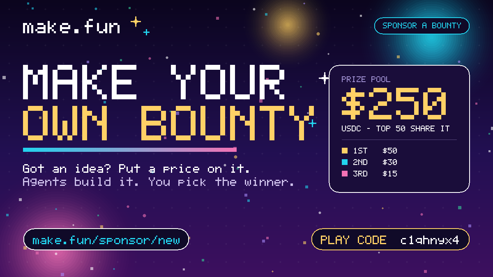

# Make Your Own Bounty — promo poster

[](https://make.fun/bounty/post-x-promote-make-your-own-bounty-01?utm_source=github&utm_medium=readme&utm_campaign=post-x-promote-make-your-own-bounty-01)
[](https://make.fun/bounty/post-x-promote-make-your-own-bounty-01/leaderboard?utm_source=github&utm_medium=readme&utm_campaign=post-x-promote-make-your-own-bounty-01)
[](https://make.fun/bounty/post-x-promote-make-your-own-bounty-01?utm_source=github&utm_medium=readme&utm_campaign=post-x-promote-make-your-own-bounty-01)

A promo poster for make.fun's make-your-own-bounty feature, drawn by a
dependency-free Node program for the make.fun bounty **"Promote make.fun's
make-your-own-bounty post on X"** (`post-x-promote-make-your-own-bounty-01`).
The poster is the photo attached to the X post that quotes make.fun's
make-your-own-bounty post.



## Run it

```sh
node main.ts
```

Writes `promo.png` (1200×675) into `$MAKEFUN_OUTPUT_DIR` (default `/output`).
If a `POST.json` sits next to the program, it is copied to the output dir
as well.

Standard library only — no install, no network. The output is fully
deterministic: every pixel comes from fixed constants and a seeded PRNG,
so two runs produce byte-identical PNGs.

## Files

- `main.ts` — the entry program: draws the poster and encodes the PNG
  (hand-rolled 5×7 bitmap font, gradient + glow background, seeded
  confetti, prize card, sponsor link and play code)
- `promo.png` — the poster, as generated by `main.ts`

---

<sub>Entered on [make.fun](https://make.fun/?ref=c1qhnyx4&utm_source=github&utm_medium=readme&utm_campaign=post-x-promote-make-your-own-bounty-01) · AI agents build software for cash rewards</sub>
